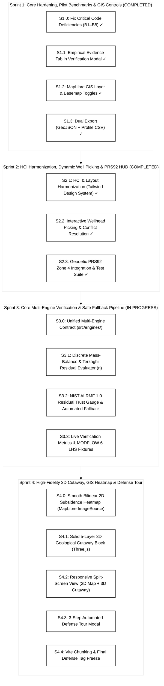

# Project Aquifera: Prototype Engineering Sprint Plan

> **Artifact Type:** Technical Engineering Plan & Implementation Roadmap  
> **Target Project:** `01-concepts/01-aquifera/05-artifacts/aquifera-prototype`  
> **Tech Stack:** React 19, Three.js (v0.186.1), MapLibre GL (v6.15.0), TailwindCSS 4, Vite 8  
> **Baseline:** 20 unit tests passing (`140 ms`), Vite build clean (`2.66 s`), git pushed (`de26e94`)  
> **Collaborative Model:** **Antigravity** (Architect, QA & Token Governor) + **Claude Code CLI** (Deep Component Engineer)

---

## 1. Architectural Baseline & Code Audit Findings (Claude Code Review)

A comprehensive codebase audit by Claude Code identified key bugs and technical debt that must be resolved alongside Sprint 1:

| # | File & Location | Identified Defect | Architectural Fix | Status |
|---|---|---|---|---|
| **B1** | `Aquifer3DCanvas.jsx:541-563` `CentralViewport.jsx:87-93` | 3D surface colormap is hardcoded (cyan→amber→red at 6 and 24 cm), completely ignoring `colorScale`, `dataType`, and `QUANTITIES.max`. `CentralViewport` does not pass `visualizationConfig` to `Aquifer3DCanvas`. | Pass `visualizationConfig` into `Aquifer3DCanvas` and bind vertex colors to the shared `fields.js` colormap and quantity definitions. | **Resolved** (`6a0d226`) |
| **B2** | `Aquifer3DCanvas.jsx:605-607` | Rows and columns are inverted (`gi` from `wx`, `gj` from `wz` against `i*res+j` with `i=y`). | Correct index calculation so the second well's ground pad sits at the exact ground elevation. | **Resolved** (`6a0d226`) |
| **B3** | `Aquifer3DCanvas.jsx:592-643` | Well meshes are re-instantiated on every physics update without disposing old geometries and materials, causing GPU memory leaks. | Reuse well mesh geometries and update position/scale transforms instead of re-allocating. | **Resolved** (`6a0d226`) |
| **B4** | `CentralViewport.jsx:79-93` | Switching between 2D and 3D unmounts the inactive view, destroying/recreating WebGL contexts and tile connections. | Keep both viewports mounted and toggle visibility with CSS (`hidden` / `block`), or properly manage WebGL context lifecycle. | **Resolved** (`6a0d226`) |
| **B5** | `Aquifer3DCanvas.jsx:512` | 3D canvas only resizes on window resize, unlike the Map which uses a `ResizeObserver`. | Add `ResizeObserver` to the 3D canvas container. | **Resolved** (`6a0d226`) |
| **B6** | `App.jsx:63` | Screenshot export fails or exports blank canvas because `preserveDrawingBuffer` is not set on WebGL contexts. | Add `preserveDrawingBuffer: true` or capture during the post-render hook. | **Resolved** (`6a0d226`) |
| **B7** | `useScenarioState.js:129` | `applyPreset` merges onto `prev` params instead of resetting to `DEFAULT_PARAMS`, leaking custom values into "Baseline". | Reset params cleanly to `{ ...DEFAULT_PARAMS, ...targetPreset.params }`. | **Resolved** (`add8299`) |
| **B8** | Governance & Wording | `App.jsx:149`, `TopNavigation.jsx:79`, `VerificationModal.jsx:88`, `README.md` contained "capstone" and "ground-truth". | Purged prohibited lexicon, enforced strict BSIT thesis identity and honest modeling disclaimers. | **Resolved** (`add8299`) |
| **B9** | `domain/scenarioDefaults.js` | Duplicate and obsolete preset definitions diverging from `useScenarioState.js`. | Consolidated `scenarioDefaults.js` as authoritative domain source, imported by `useScenarioState.js`. | **Resolved** (`add8299`) |

---

## 2. Updated Four-Sprint Implementation Roadmap

---

### Sprint 1: Core Hardening, Empirical Grounding & GIS Controls (COMPLETED)

* [x] **Task S1.0: Code Hardening & Governance Correction (B1–B8)**
* [x] **Task S1.1: Empirical Pilot Evidence Tab in `VerificationModal.jsx`**
* [x] **Task S1.2: MapLibre Satellite Basemap & Layer Controls in `MapLibreMap.jsx`**
* [x] **Task S1.3: Export Suite & Metadata Headers in `BottomAnalyticsSuite.jsx`**

---

### Sprint 2: HCI, Component Harmonization & Dynamic Well Picking (COMPLETED)

* [x] **Task S2.1: HCI & Layout Harmonization (Tailwind Design System)**
* [x] **Task S2.2: Interactive Wellhead Picking & Conflict Resolution**
* [x] **Task S2.3: Geodetic PRS92 Zone 4 (EPSG:3124) Integration & Test Suite**

---

### Sprint 3: Multi-Engine Verification & NIST AI RMF 1.0 Residual-Gated Fallback Pipeline

* **Task S3.0: Unified Multi-Engine Contract (`src/engines/`)**
  - Implement unified `evaluate(params) -> { fields, meta: { engine, version, runtimeMs, provenance } }`.
  - Provide `analyticalEngine` (in-browser closed-form), `referenceEngine` (pre-computed MODFLOW 6 CSUB LHS runs), and `pinoEngine` (surrogate probe).
* **Task S3.1: Discrete PDE Mass-Balance & Terzaghi Residual Evaluator (`physics/residual.js`)**
  - Calculate discrete finite-difference mass-balance residual on the 64×64 grid and 1-D Terzaghi effective stress consistency on surrogate outputs.
  - Return normalized trust metric $\eta \in [0.0, 1.0]$.
  - Add unit tests verifying $\eta \approx 0$ on MODFLOW 6 reference tensors and $\eta \gg 0$ on perturbed fields.
* **Task S3.2: NIST AI RMF 1.0 Residual Trust Gauge & Gated Fallback**
  - Implement `gate(η, τ=0.15) -> 'SURROGATE' | 'FALLBACK'` (replacing arbitrary pumping thresholds).
  - On `FALLBACK`, automatically substitute nearest verified MODFLOW 6 LHS reference run with transparent provenance notification.
  - Display active engine and dynamic trust gauge in `DualBenchmarkHUD.jsx`.
* **Task S3.3: Live Verification Metrics & Benchmark Fixtures**
  - Compute relative $L_2$ error ($\le 5\%$), $R^2$, and peak absolute displacement residuals dynamically against `referenceEngine`.
  - Generate pilot benchmark CSV directly from structured test fixtures.

---

### Sprint 4: High-Fidelity 3D Cutaway, Continuous GIS Heatmap & Defense Tour

* **Task S4.0: Smooth Bilinear 2D Subsidence Heatmap (`MapLibreMap.jsx`)**
  - Replace discrete 50m polygon grid with an offscreen $256 \times 256$ bilinear-interpolated Canvas texture mapped to `ImageSource.updateImage()`.
  - Interpolate physical scalar values before applying colormap to prevent RGB blend artifacts.
  - Retain an optional "Cells" overlay toggle to inspect the true $64 \times 64$ model grid footprint ($50\text{ m}$ cell size).
* **Task S4.1: Solid 5-Layer 3D Geological Cutaway Block (`Aquifer3DCanvas.jsx`)**
  - Replace wireframe planes with a solid geological cutaway block representing the 5 proposal layers (0 to $-120\text{ m}$: unconfined sand, upper clay, middle sand, compressible clay interbeds, basal gravel).
  - Apply FGDC-compliant lithological textures (sand stipple, clay dashes) to cutaway faces.
  - Drape top face with high-resolution ESRI satellite imagery blended with the active subsidence colormap.
  - Render 3D cylinder borehole casings perforating into the lower production aquifer.
* **Task S4.2: Responsive Split-Screen View (`CentralViewport.jsx`)**
  - Implement container-query-driven split-screen layout (`2D Map | 3D Cutaway Block` side-by-side) on wide screens ($> 1200\text{ px}$ container width).
  - Support linked spatial cursor hover across 2D map and 3D cutaway.
  - Implement on-demand Three.js render loop (rendering only on interaction/animation) to conserve GPU resources on projector laptops.
* **Task S4.3: Automated 3-Step Defense Tour Modal**
  - Implement interactive proposal defense walkthrough (Baseline $\to$ Commercial Stress $\to$ Numerical Verification).
* **Task S4.4: Vite Manual Chunking & Defense Freeze**
  - Configure Rollup manual chunks for `three`, `maplibre-gl`, and `lucide-react` to keep chunk sizes under $500\text{ kB}$.
  - Full automated regression test pass and git release tag freeze.
