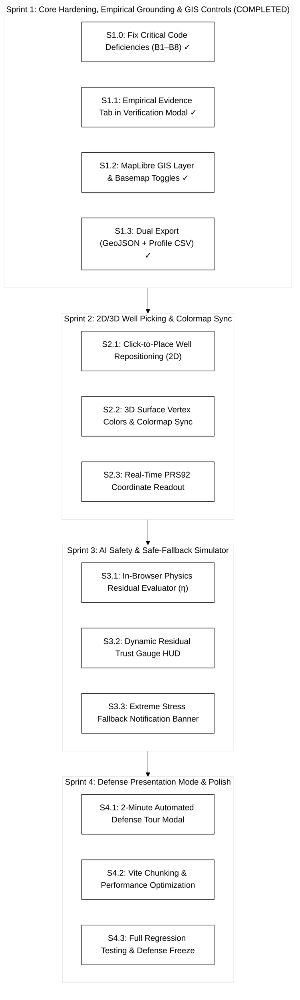

# Project Aquifera: Prototype Engineering Sprint Plan

> **Artifact Type:** Technical Engineering Plan & Implementation Roadmap  
> **Target Project:** `01-concepts/01-aquifera/05-artifacts/aquifera-prototype`  
> **Tech Stack:** React 19, Three.js (r182), MapLibre GL 5, TailwindCSS 4, Vite 8  
> **Baseline:** 15 unit tests passing (`103 ms`), Vite build clean (`2.54 s`), git pushed (`91b048b`)  
> **Collaborative Model:** **Antigravity** (Architect, QA & Token Governor) + **Claude Code CLI** (Deep Component Engineer)

---

## 1. Architectural Baseline & Code Audit Findings (Claude Code Review)

A comprehensive codebase audit by Claude Code identified key bugs and technical debt that must be resolved alongside Sprint 1:

| # | File & Location | Identified Defect | Architectural Fix | Status |
|---|---|---|---|---|
| **B1** | `Aquifer3DCanvas.jsx:541-563` `CentralViewport.jsx:87-93` | 3D surface colormap is hardcoded (cyan→amber→red at 6 and 24 cm), completely ignoring `colorScale`, `dataType`, and `QUANTITIES.max`. `CentralViewport` does not pass `visualizationConfig` to `Aquifer3DCanvas`. | Pass `visualizationConfig` into `Aquifer3DCanvas` and bind vertex colors to the shared `fields.js` colormap and quantity definitions. | **Resolved** (`6a0d226`) |
| **B2** | `Aquifer3DCanvas.jsx:605-607` | Rows and columns are inverted (`gi` from `wx`, `gj` from `wz` against `i*res+j` with `i=y`). | Correct index calculation so the second well's ground pad sits at the exact ground elevation. | **Resolved** (`6a0d226`) |
| **B3** | `Aquifer3DCanvas.jsx:592-643` | Well meshes are re-instantiated on every physics update without disposing old geometries and materials, causing GPU memory leaks. | Reuse well mesh geometries and update position/scale transforms instead of re-allocating. | **Resolved** (`6a0d226`) |
| **B4** | `CentralViewport.jsx:79-93` | Switching between 2D and 3D unmounts the inactive view, destroying/recreating WebGL contexts and tile connections. | Keep both viewports mounted and toggle visibility with CSS (`hidden` / `block`), or properly manage WebGL context lifecycle. | **Resolved** (`6a0d226`) |
| **B5** | `Aquifer3DCanvas.jsx:512` | 3D canvas only resizes on window resize, unlike the Map which uses a `ResizeObserver`. | Add `ResizeObserver` to the 3D canvas container. | **Resolved** (`6a0d226`) |
| **B6** | `App.jsx:63` | Screenshot export fails or exports blank canvas because `preserveDrawingBuffer` is not set on WebGL contexts. | Add `preserveDrawingBuffer: true` or capture during the post-render hook. | **Resolved** (`6a0d226`) |
| **B7** | `useScenarioState.js:129` | `applyPreset` merges onto `prev` params instead of resetting to `DEFAULT_PARAMS`, leaking custom values into "Baseline". | Reset params cleanly to `{ ...DEFAULT_PARAMS, ...targetPreset.params }`. | **Resolved** (`add8299`) |
| **B8** | Governance & Wording | `App.jsx:149`, `TopNavigation.jsx:79`, `VerificationModal.jsx:88`, `README.md` contained "capstone" and "ground-truth". | Purged prohibited lexicon, enforced strict BSIT thesis identity and honest modeling disclaimers. | **Resolved** (`add8299`) |
| **B9** | `domain/scenarioDefaults.js` | Duplicate and obsolete preset definitions diverging from `useScenarioState.js`. | Consolidated `scenarioDefaults.js` as authoritative domain source, imported by `useScenarioState.js`. | **Resolved** (`add8299`) |

---

## 2. Updated Four-Sprint Implementation Roadmap

---

### Sprint 1: Core Hardening, Empirical Grounding & GIS Controls (COMPLETED)

* [x] **Task S1.0: Code Hardening & Governance Correction (B1–B8)**
  - Corrected `App.jsx:149` from "capstone defense" to "BSIT thesis".
  - Corrected `CentralViewport.jsx:72` to "WGS84 Web Mercator (Exports to PRS92 Zone 4)".
  - Fixed `useScenarioState.js:129` preset parameter leak.
  - Implemented canvas `preserveDrawingBuffer` for screenshot exports.
  - Fixed `Aquifer3DCanvas` well index row/col swap (Bug #2).
  - Passed `visualizationConfig` into `Aquifer3DCanvas` and bound colors to shared `fields.js` (Bug #1).
  - Maintained persistent 2D and 3D viewports in the DOM to avoid WebGL context loss (Bug #4).
  - Added container `ResizeObserver` to 3D canvas (Bug #5).
* [x] **Task S1.1: Empirical Pilot Evidence Tab in `VerificationModal.jsx`**
  - Added dedicated **"Empirical Pilot Evidence"** tab featuring the October 23 benchmark findings:
    - USGS MODFLOW 6 runtime: 22.5 s ($64 \times 64 \times 5 = 20,480$ cells).
    - PINO forward inference: 38.6 ms ($580\times$ speedup) using 2.14 GB VRAM on NVIDIA RTX 4050.
    - Embedded visual summary of Attachment Fig. A1 (75.2 mm compaction bowl in PRS92 Zone 4).
    - Added dedicated pilot benchmark CSV export button.
* [x] **Task S1.2: MapLibre Satellite Basemap & Layer Controls in `MapLibreMap.jsx`**
  - Added floating layer controller:
    - Basemap toggle: **ESRI Dark Canvas** ⇄ **ESRI World Imagery** (satellite aerial photo).
    - Vector layer toggles: Barangay boundaries (PSA/NAMRIA), City boundary, 3.2km domain outline, and Wells.
    - Simulation grid opacity slider (0% to 100%).
* [x] **Task S1.3: Export Suite & Metadata Headers in `BottomAnalyticsSuite.jsx`**
  - Wired dual export buttons: RFC 7946 GeoJSON and Cross-Section Profile CSV with research disclaimer headers.

---

### Sprint 2: HCI, Component Harmonization & Dynamic Well Picking (COMPLETED)

* [x] **Task S2.1: HCI & Layout Harmonization (Tailwind Design System)**
  - Standardized all panels on Tailwind slate/cyan tokens (`slate-950`, `slate-900`, `slate-800`, `cyan-400`).
  - Streamlined `TopNavigation.jsx` to `h-14` (56px) with Global Research Integrity Status Pill.
  - Overhauled `ScenarioSetupPanel.jsx` into 4 distinct, color-coded preset cards with clear `Theis + Terzaghi (Analytical)` attribution.
  - Replaced amber disclaimer banners with clean, professional geodetic coordinate HUD and research pills.
  - Implemented collapsible **Analytical Suite Telemetry Dock** (`BottomAnalyticsSuite.jsx`) fitting 100dvh laptops.
  - Hardened `VerificationModal.jsx` with accessible dialog containment (`max-h-[min(90dvh,52rem)]`, Escape key listener, scrollable body).
* [x] **Task S2.2: Interactive Wellhead Picking & Conflict Resolution**
  - Added dedicated Well Relocation mode toggle in `MapLibreMap.jsx` (`Crosshair` tool) and instant `Shift + Click` modifier.
  - Resolved click conflicts between cell inspection and wellhead movement (Claude Code audit H1).
  - Bound atomic parameter updates `setParams(p => ({ ...p, wellX, wellY }))` in `App.jsx` (audit H4).
* [x] **Task S2.3: Geodetic PRS92 Zone 4 (EPSG:3124) Integration & Test Suite**
  - Corrected geodetic projection to PRS92 Zone 4 (EPSG:3124, Central Meridian 123° E, False Easting 500,000 m).
  - Aligned anchor coordinates (`451,800 m E`, `1,187,000 m N`) with the verified `smoke_test_mf6_prs92.py` domain center.
  - Throttled mousemove coordinates via `requestAnimationFrame` and cleared on mouseout (audit H2).
  - Added full test suite `tests/physics/geodesy.test.js` validating invertibility and control points.

---

### Sprint 3: Multi-Engine Verification & NIST AI RMF 1.0 Residual-Gated Fallback Pipeline

* **Task S3.0: Unified Multi-Engine Contract (`src/engines/`)**
  - Implement unified `evaluate(params) -> { fields, meta: { engine, version, runtimeMs, provenance } }`.
  - Provide `analyticalEngine` (in-browser closed-form), `referenceEngine` (pre-computed MODFLOW 6 CSUB LHS runs), and `pinoEngine` (surrogate probe).
* **Task S3.1: Discrete PDE Mass-Balance & Terzaghi Residual Evaluator (`physics/residual.js`)**
  - Calculate discrete finite-difference mass-balance residual on the 64×64 grid and 1-D Terzaghi effective stress consistency on surrogate outputs.
  - Return normalized trust metric $\eta \in [0.0, 1.0]$.
  - Add unit tests verifying $\eta \approx 0$ on MODFLOW 6 reference tensors and $\eta \gg 0$ on perturbed fields.
* **Task S3.2: NIST AI RMF 1.0 Residual Trust Gauge & Gated Fallback**
  - Implement `gate(η, τ=0.15) -> 'SURROGATE' | 'FALLBACK'` (replacing arbitrary pumping thresholds).
  - On `FALLBACK`, automatically substitute nearest verified MODFLOW 6 LHS reference run with transparent provenance notification.
  - Display active engine and dynamic trust gauge in `DualBenchmarkHUD.jsx`.
* **Task S3.3: Live Verification Metrics & Benchmark Fixtures**
  - Compute relative $L_2$ error ($\le 5\%$), $R^2$, and peak absolute displacement residuals dynamically against `referenceEngine`.
  - Generate pilot benchmark CSV directly from structured test fixtures.

---

### Sprint 4: Defense Presentation Tour & Performance Hardening

* **Task S4.1: "Defense Demo Tour" Floating Modal**
  - Implement a 3-step automated walkthrough button for the proposal defense presentation:
    1. *Baseline Delta* (normal extraction).
    2. *Commercial Corridor Stress* (Mandurriao clustering, permanent clay compaction).
    3. *Verification & GIS Export* (One-click MODFLOW check + QGIS export).
* **Task S4.2: Vite Chunking & Performance Optimization**
  - Configure `vite.config.js` with manual chunks for `three`, `maplibre-gl`, and `lucide-react` to optimize bundle load times.
* **Task S4.3: Regression Testing & Defense Freeze**
  - Run full automated test suite (`npm test`), verify clean builds (`npm run build`), and freeze git release tag.
