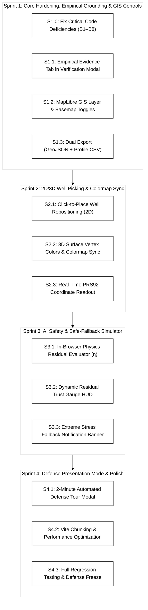

# Project Aquifera: Prototype Engineering Sprint Plan

> **Artifact Type:** Technical Engineering Plan & Implementation Roadmap  
> **Target Project:** `01-concepts/01-aquifera/05-artifacts/aquifera-prototype`  
> **Tech Stack:** React 19, Three.js (r182), MapLibre GL 5, TailwindCSS 4, Vite 8  
> **Baseline:** 15 unit tests passing (`103 ms`), Vite build clean (`2.54 s`), git pushed (`91b048b`)  
> **Collaborative Model:** **Antigravity** (Architect, QA & Token Governor) + **Claude Code CLI** (Deep Component Engineer)

---

## 1. Architectural Baseline & Code Audit Findings (Claude Code Review)

A comprehensive codebase audit by Claude Code identified key bugs and technical debt that must be resolved alongside Sprint 1:

| # | File & Location | Identified Defect | Architectural Fix |
|---|---|---|---|
| **B1** | `Aquifer3DCanvas.jsx:541-563` `CentralViewport.jsx:87-93` | 3D surface colormap is hardcoded (cyan→amber→red at 6 and 24 cm), completely ignoring `colorScale`, `dataType`, and `QUANTITIES.max`. `CentralViewport` does not pass `visualizationConfig` to `Aquifer3DCanvas`. | Pass `visualizationConfig` into `Aquifer3DCanvas` and bind vertex colors to the shared `fields.js` colormap and quantity definitions. |
| **B2** | `Aquifer3DCanvas.jsx:605-607` | Rows and columns are inverted (`gi` from `wx`, `gj` from `wz` against `i*res+j` with `i=y`). | Correct index calculation so the second well's ground pad sits at the exact ground elevation. |
| **B3** | `Aquifer3DCanvas.jsx:592-643` | Well meshes are re-instantiated on every physics update without disposing old geometries and materials, causing GPU memory leaks. | Reuse well mesh geometries and update position/scale transforms instead of re-allocating. |
| **B4** | `CentralViewport.jsx:79-93` | Switching between 2D and 3D unmounts the inactive view, destroying/recreating WebGL contexts and tile connections. | Keep both viewports mounted and toggle visibility with CSS (`hidden` / `block`), or properly manage WebGL context lifecycle. |
| **B5** | `Aquifer3DCanvas.jsx:512` | 3D canvas only resizes on window resize, unlike the Map which uses a `ResizeObserver`. | Add `ResizeObserver` to the 3D canvas container. |
| **B6** | `App.jsx:63` | Screenshot export fails or exports blank canvas because `preserveDrawingBuffer` is not set on WebGL contexts. | Add `preserveDrawingBuffer: true` or capture during the post-render hook. |
| **B7** | `useScenarioState.js:129` | `applyPreset` merges onto `prev` params instead of resetting to `DEFAULT_PARAMS`, leaking custom clay values into "Baseline". | Merge presets onto `DEFAULT_PARAMS`. |
| **B8** | Governance & Wording | `App.jsx:149` says "capstone defense" (prohibited; this is a **BSIT Thesis**). `CentralViewport.jsx:72` says "PRS92 / WGS84" when frontend is WGS84. `groundwaterPhysics.js:4` claims MODFLOW 6 CSUB equivalence instead of Theis/Terzaghi approximation. | Correct governance wording to strict BSIT Thesis and honest modeling disclaimers. |

---

## 2. Updated Four-Sprint Implementation Roadmap

---

### Sprint 1: Core Hardening, Empirical Grounding & GIS Controls

* **Task S1.0: Code Hardening & Governance Correction (B1–B8)**
  - Correct `App.jsx:149` from "capstone defense" to "BSIT thesis".
  - Correct `CentralViewport.jsx:72` to "WGS84 Web Mercator (Exports to PRS92 Zone 4)".
  - Fix `useScenarioState.js:129` preset parameter leak.
  - Implement canvas `preserveDrawingBuffer` for screenshot exports.
  - Fix `Aquifer3DCanvas` well index row/col swap (Bug #2).
  - Pass `visualizationConfig` into `Aquifer3DCanvas` (Bug #1).
* **Task S1.1: Empirical Pilot Evidence Tab in `VerificationModal.jsx`**
  - Add a dedicated **"Empirical Pilot Evidence"** tab featuring the October 23 benchmark findings:
    - USGS MODFLOW 6 runtime: 22.5 s ($64 \times 64 \times 5 = 20,480$ cells).
    - PINO forward inference: 38.6 ms ($580\times$ speedup) using 2.14 GB VRAM on NVIDIA RTX 4050.
    - Embedded visual summary of Attachment Fig. A1 (75.2 mm compaction bowl in PRS92 Zone 4).
* **Task S1.2: MapLibre Satellite Basemap & Layer Controls in `MapLibreMap.jsx`**
  - Add a floating layer controller:
    - Basemap toggle: **ESRI Dark Canvas** ⇄ **ESRI World Imagery** (satellite aerial photo).
    - Vector layer toggles: Barangay boundaries, City boundary, and simulation grid opacity slider.
* **Task S1.3: Export Suite & Metadata Headers in `BottomAnalyticsSuite.jsx`**
  - Wire dual export buttons: RFC 7946 GeoJSON and Cross-Section Profile CSV with research disclaimer headers.

---

### Sprint 2: Dynamic 2D/3D Well Picking & Colormap Sync

* **Task S2.1: Click-to-Place Well Repositioning in `MapLibreMap.jsx`**
  - Enable clicking on the 2D map to move Well 1 or Well 2, calling `setParams(p => ({ ...p, wellX, wellY }))` atomically.
* **Task S2.2: Colormap Unification (`colormap.js`)**
  - Create a shared `src/physics/colormap.js` module.
  - Bind Three.js surface vertex colors to `visualizationConfig.colorScale` (`standard`, `viridis`, `turbo`) and `visualizationConfig.dataType` (`subsidence`, `drawdown`, `inelastic`) so 2D and 3D always display identical colors.
* **Task S2.3: Three.js Mesh Disposal & Memory Optimization**
  - Reuse well mesh geometries and clean up event listeners to eliminate WebGL memory leaks during slider adjustments.

---

### Sprint 3: NIST AI RMF 1.0 Residual-Gated Safe Fallback Simulator

* **Task S3.1: In-Browser Physics Residual Evaluator in `groundwaterPhysics.js`**
  - Implement local PDE residual calculation checking mass conservation and Terzaghi effective stress continuity. Returns $\eta \in [0.0, 1.0]$.
* **Task S3.2: Dynamic Residual Trust Gauge in `DualBenchmarkHUD.jsx`**
  - Display active trust score $\eta$ with color-coded safety badges (Green: $\eta \le 0.15$ `SURROGATE ACTIVE`; Amber/Red: $\eta > 0.15$ `SAFE FALLBACK ENGAGED`).
* **Task S3.3: Automated Fallback Notification in `App.jsx`**
  - Trigger an animated NIST AI RMF 1.0 notification banner under extreme pumping stresses ($Q > 18,000\text{ m}^3/\text{d}$).

---

### Sprint 4: Defense Presentation Tour & Performance Hardening

* **Task S4.1: "Defense Demo Tour" Floating Modal**
  - Implement a 3-step automated walkthrough button for the proposal defense presentation:
    1. *Baseline Delta* (normal extraction).
    2. *Commercial Corridor Stress* (Mandurriao clustering, permanent clay compaction).
    3. *Verification & GIS Export* (One-click MODFLOW check + QGIS export).
* **Task S4.2: Vite Chunking & Performance Optimization**
  - Configure `vite.config.js` with manual chunks for `three`, `maplibre-gl`, and `lucide-react` to optimize bundle load times.
* **Task S4.3: Regression Testing & Defense Freeze**
  - Run full automated test suite (`npm test`), verify clean builds (`npm run build`), and freeze git release tag.
