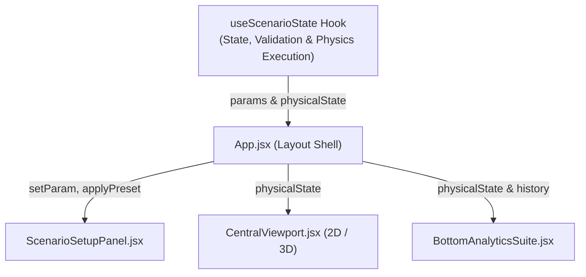

# AQUIFERA: Modular Refactoring, Architecture Boundaries, and Scientific Integrity Plan

**West Visayas State University | College of Information and Communications Technology (CICT)**  
*Bachelor of Science in Information Technology (BSIT) | Course: CC 208 (Methods of Research in Computing)*  
*Academic Year 2026–2027 | Research Group 2*

---

## 1. Executive Summary and Problem Statement

Following the successful deployment of the **MapLibre GL JS** 2D GIS basemap and the **Three.js** 3D subsurface cutaway stage, the AQUIFERA prototype has established its core visual foundation. However, an in-depth codebase audit reveals technical and architectural debt that must be addressed before multi-member collaborative development proceeds:

1. **Dead Legacy Code (38.1 KB):** Three large components (`ControlsPanel.jsx`, `MetroIloilo2DMap.jsx`, and `MapLayersOverlay.jsx`) remain in `src/components/` despite having zero active imports, creating confusion for developers and evaluators.
2. **State Entanglement in the App Shell:** `src/App.jsx` directly coordinates scenario parameters, timer states, preset mutations, physics recalculation, and layout rendering. Any team member editing parameters or charts must modify `App.jsx`, risking frequent git merge conflicts.
3. **Missing Defense Documentation Artifacts:** While the UI now displays clear disclaimer badges, the project lacks formal documentation defining dataset origins (`DATA-PROVENANCE.md`) and the operational boundaries between client-side demonstration math and backend verification pipelines (`SCIENTIFIC-VALIDATION.md`).

This plan outlines a controlled, 5-phase refactoring roadmap that resolves architectural debt without breaking working features.

---

## 2. Component Inventory and Hygiene Strategy

### 2.1 Active Component Map
```text
src/
├── App.jsx                        # Layout composer & modal orchestrator
├── main.jsx                       # React 19 root entrypoint
├── index.css                      # Tailwind v4, MapLibre styles & design tokens
├── components/
│   ├── TopNavigation.jsx          # Brand header, view navigation, export actions
│   ├── ScenarioSetupPanel.jsx     # Scenario presets & hydrological sliders
│   ├── CentralViewport.jsx        # Dual-mode container (MapLibre ⇄ Three.js)
│   ├── MapLibreMap.jsx            # 2D GIS map, GeoJSON grid & cell inspector
│   ├── Aquifer3DCanvas.jsx        # 3D Three.js stratified geotechnical mesh
│   ├── DualBenchmarkHUD.jsx       # Benchmark targets telemetry overlay
│   ├── BottomAnalyticsSuite.jsx   # Cross-section heatmap & time-series hydrograph
│   ├── VerificationModal.jsx      # Tier 4 FloPy / MODFLOW 6 demonstration dialog
│   └── GuideModal.jsx             # Research background & architectural guide
├── data/
│   ├── metroIloiloGIS.js          # Geographic coordinates & district metadata
│   └── scenarioPresets.js         # Hydrogeological reference presets
└── physics/
    └── groundwaterPhysics.js      # Theis radial drawdown & Terzaghi 1D consolidation
```

### 2.2 Confirmed Dead Components to Archive
The following files have 0 incoming imports across the entire workspace:

| File Name | File Size | Original Purpose | Current Replacement | Action |
| :--- | :--- | :--- | :--- | :--- |
| **`ControlsPanel.jsx`** | 24,483 B | Early monolithic parameter sidebar | `ScenarioSetupPanel.jsx` | Retire / Archive |
| **`MetroIloilo2DMap.jsx`** | 8,865 B | Hardcoded 2D canvas drawing | `MapLibreMap.jsx` | Retire / Archive |
| **`MapLayersOverlay.jsx`** | 4,808 B | Floating layer toggle checklist | Integrated into MapLibre & Three.js toolbars | Retire / Archive |

**Total Dead Code Elimination:** 38,156 bytes (~38 KB).

---

## 3. State Modularization: The `useScenarioState` Hook

### 3.1 Design Contract
To separate layout composition from scenario mutation logic, extract all reactive hydrological parameters into a dedicated custom hook: `src/hooks/useScenarioState.js`.



### 3.2 State Interface Specification
```javascript
export function useScenarioState() {
  // 1. Authoritative Parameter State
  // { pumpingRate, hydraulicConductivity, specificStorage, rechargeRateMmYear, ... }
  
  // 2. Deterministic Physical State
  // computeGroundwaterState(params) -> maxDrawdownM, maxSubsidenceCm, isPlastic, ...
  
  // 3. Status and Presets
  // activePreset, isSimulating, lastUpdatedTimestamp
  
  // 4. Action Handlers
  // setParam(key, value), applyPreset(presetId), runDemonstration(), resetToBaseline()
  
  return {
    params,
    physicalState,
    isSimulating,
    activePreset,
    setParam,
    applyPreset,
    runDemonstration,
    resetToBaseline
  };
}
```

---

## 4. Academic Defense Documentation Standards

To protect Group 2 during proposal and defense questioning, two canonical markdown artifacts will be added to `docs/`:

### 4.1 `docs/DATA-PROVENANCE.md`
* **Cartographic Base:** OpenStreetMap and CARTO Dark Matter raster tiles (WGS84 / PRS92 alignment, zero API key requirement, open redistribution terms).
* **Geographic Extent:** Metro Iloilo deltaic plain bounded by `10.665° N – 10.775° N` and `122.495° E – 122.625° E`.
* **District Centroids:** Document exact geographic coordinates for Mandurriao (`10.7165, 122.5480`), City Proper (`10.6975, 122.5725`), Jaro (`10.7380, 122.5560`), Molo (`10.7010, 122.5390`), La Paz (`10.7120, 122.5760`), and Leganes (`10.7650, 122.5920`).
* **Geotechnical Assumptions:** Stratified layer depths (0–30 m sand, 30–60 m marine clay, 60–120 m confined aquifer) cited against regional hydrogeological literature.
* **Integrity Classification:** Explicitly labels all grid cell values as deterministic synthetic models for demonstration.

### 4.2 `docs/SCIENTIFIC-VALIDATION.md`
* **Validation Hierarchy:** Formally defines the four tiers of computing validation:
  1. *Tier 1 (Browser Demonstration):* Client-side closed-form analytical approximations for interactive exploration.
  2. *Tier 2 (Physical Verification):* Automated mass conservation tests verifying that fluid outflow matches storage depletion without unphysical rebound.
  3. *Tier 3 (Neural Operator Training):* Offline 3D Fourier Neural Operator (PINO) trained on high-performance compute against synthetic MODFLOW 6 datasets.
  4. *Tier 4 (Gold Standard Numerical Ground Truth):* USGS MODFLOW 6 CSUB finite-difference simulation via FloPy.
* **Defense Talking Points:** Provides ready answers for panel questions regarding the difference between client-side demonstration data and backend numerical verification.

---

## 5. Parallel Team Ownership (BSIT Group 2)

To prevent file collision and git merge conflicts among the 5 group members, responsibilities are partitioned along feature boundaries:

```
┌────────────────────────────────────────────────────────────────────────┐
│                   MARK ALVIN C. CADANGIN (Lead)                        │
│   • App.jsx, TopNavigation.jsx, useScenarioState.js, CI & Build       │
└──────────────┬──────────────────────────┬──────────────────────────────┘
               │                          │
               ▼                          ▼
┌──────────────────────────────┐ ┌──────────────────────────────────────┐
│     NHERIE C. ACEBUCHE       │ │       JUSTIN ACE A. ARDEÑA           │
│ • ScenarioSetupPanel.jsx     │ │ • MapLibreMap.jsx                    │
│ • Presets & Sliders          │ │ • GeoJSON Subsidence Grids           │
│ • Input Validation           │ │ • Geographic Coordinates & Legends   │
└──────────────────────────────┘ └──────────────────────────────────────┘
               │                          │
               ▼                          ▼
┌──────────────────────────────┐ ┌──────────────────────────────────────┐
│ MAE DANIELLA FAITH BENJAMIN  │ │      VINCENT JOHN A. TAMAÑO          │
│ • Aquifer3DCanvas.jsx        │ │ • BottomAnalyticsSuite.jsx           │
│ • Three.js Strata & Cutaway  │ │ • VerificationModal.jsx              │
│ • Shader Mesh Deformation    │ │ • Scientific Documentation & Tests   │
└──────────────────────────────┘ └──────────────────────────────────────┘
```

---

## 6. Phased Implementation Roadmap

### Phase 1: Repository Hygiene and Dead Code Retirement
- **Action:** Move the 3 confirmed dead components (`ControlsPanel.jsx`, `MetroIloilo2DMap.jsx`, `MapLayersOverlay.jsx`) into an archive directory `docs/archive/legacy-components/` or delete them from `src/components/`.
- **Gate:** Verify `npm run build` succeeds and `npm run lint` reports 0 errors.

### Phase 2: State Modularization (`useScenarioState`)
- **Action:** Create `src/hooks/useScenarioState.js` containing authoritative state management, preset definitions, and reactive physics calculations.
- **Action:** Refactor `src/App.jsx` to consume `useScenarioState`.
- **Gate:** Ensure changing pumping rate or presets continues to update the 2D map, 3D cutaway, and analytics charts deterministically.

### Phase 3: Defense Documentation Suite
- **Action:** Author `docs/DATA-PROVENANCE.md` detailing coordinates, tile sources, and soil strata parameters.
- **Action:** Author `docs/SCIENTIFIC-VALIDATION.md` detailing the 4-tier validation hierarchy and defense talking points.
- **Action:** Update `docs/README.md` to link to these new records.
- **Gate:** Check for zero em dashes across all created markdown files.

### Phase 4: Layout and Ergonomics Validation
- **Action:** Test responsive behavior across 1920x1080, 1440x900, 1366x768, and 1024x768 resolutions.
- **Action:** Verify that no content is clipped and all controls remain keyboard-accessible.
- **Gate:** Production build passes in under 600 ms.

### Phase 5: Version Control Sync
- **Action:** Stage all changes under conventional commit message:  
  `refactor(prototype): isolate scenario state hook, retire dead code, and add defense docs`
- **Action:** Push cleanly to `origin/main` on `Thesis-Titans/aquifera-prototype.git`.
