# Project Aquifera: Prototype Engineering Sprint Plan

> **Artifact Type:** Technical Engineering Plan & Implementation Roadmap  
> **Target Project:** `01-concepts/01-aquifera/05-artifacts/aquifera-prototype`  
> **Tech Stack:** React 19, Three.js (v0.186.1), MapLibre GL (v6.15.0), TailwindCSS 4, Vite 8  
> **Baseline:** 48 unit tests passing, Vite build clean (<700 ms), 0 errors  
> **Collaborative Model:** **Antigravity** (Architect, QA & Token Governor) + **Claude Code CLI** (Deep Component Engineer)

---

## 1. Architectural Baseline & Code Audit Findings

A comprehensive codebase audit resolved foundational defects and technical debt across Sprints 1 to 4:

| # | File & Location | Identified Defect | Architectural Fix | Status |
|---|---|---|---|---|
| **B1** | `Aquifer3DCanvas.jsx` `CentralViewport.jsx` | 3D surface colormap was hardcoded; `visualizationConfig` not bound. | Bound vertex colors to shared `fields.js` colormap and dynamic quantities. | **Resolved** (`6a0d226`) |
| **B2** | `Aquifer3DCanvas.jsx` | Rows and columns inverted on secondary well ground pad. | Corrected index calculation for exact well elevation placement. | **Resolved** (`6a0d226`) |
| **B3** | `Aquifer3DCanvas.jsx` | Well meshes re-instantiated on every update without GPU resource disposal. | Reused well mesh geometries and updated transforms; added full disposal cycle. | **Resolved** (`6a0d226`) |
| **B4** | `CentralViewport.jsx` | 2D/3D toggle unmounted inactive view, dropping WebGL context. | Maintained mounted state with CSS visibility toggling and context preservation. | **Resolved** (`6a0d226`) |
| **B5** | `Aquifer3DCanvas.jsx` | 3D canvas resized only on window events rather than container resize. | Implemented `ResizeObserver` on the 3D canvas container. | **Resolved** (`6a0d226`) |
| **B6** | `App.jsx` | Screenshot export captured blank buffer. | Configured `preserveDrawingBuffer: true` and active viewport resolution. | **Resolved** (`6a0d226`) |
| **B7** | `useScenarioState.js` | Preset switching leaked custom parameters into baseline state. | Enforced clean state reset via `{ ...DEFAULT_PARAMS, ...targetPreset.params }`. | **Resolved** (`add8299`) |
| **B8** | Governance & Wording | Stray "capstone" and "ground-truth" terms in UI. | Enforced strict BSIT thesis identity and "reference numerical solution" terminology. | **Resolved** (`add8299`) |
| **B9** | `domain/scenarioDefaults.js` | Divergent preset definitions. | Consolidated `scenarioDefaults.js` as single authoritative domain source. | **Resolved** (`add8299`) |

---

## 2. Completed Four-Sprint Implementation Roadmap

```mermaid
%%{init: {'theme': 'base', 'themeVariables': {'primaryColor': '#ffffff', 'primaryTextColor': '#000000', 'primaryBorderColor': '#000000', 'lineColor': '#000000'}}}%%
flowchart TD
    subgraph SP1["Sprint 1: Core Hardening & GIS Controls (COMPLETED)"]
        T10["S1.0: Fix Critical Deficiencies (B1–B8) ✓"]
        T11["S1.1: Empirical Evidence Tab in Verification Modal ✓"]
        T12["S1.2: MapLibre GIS Layer & Basemap Toggles ✓"]
        T13["S1.3: Dual Export (GeoJSON + Profile CSV) ✓"]
    end

    subgraph SP2["Sprint 2: HCI, Well Picking & PRS92 HUD (COMPLETED)"]
        T21["S2.1: HCI & Layout Harmonization (Tailwind) ✓"]
        T22["S2.2: Interactive Wellhead Picking & Conflict Resolution ✓"]
        T23["S2.3: Geodetic PRS92 Zone 4 Integration & Test Suite ✓"]
    end

    subgraph SP3["Sprint 3: Multi-Engine & NIST Residual Fallback (COMPLETED)"]
        T30["S3.0: Unified Multi-Engine Contract (src/engines/) ✓"]
        T31["S3.1: Discrete Mass-Balance & Residual Evaluator (η) ✓"]
        T32["S3.2: NIST AI RMF 1.0 Trust Gauge & Automated Fallback ✓"]
        T33["S3.3: Verification Residual Metrics & Reference Fixtures ✓"]
    end

    subgraph SP4["Sprint 4: 3D Cutaway, Bilinear Heatmap & Defense Tour (COMPLETED)"]
        T40["S4.0: Smooth Bilinear 2D Subsidence Heatmap (ImageSource) ✓"]
        T41["S4.1: Solid 5-Layer 3D Geological Cutaway Block ✓"]
        T42["S4.2: Responsive Split-Screen View (2D Map + 3D Cutaway) ✓"]
        T43["S4.3: 3-Step Automated Defense Tour Modal ✓"]
        T44["S4.4: Vite Manual Chunking & Performance Optimization ✓"]
    end

    subgraph SP5["Sprint 5: Empirical Ingestion & Boundary Data Integration (COMPLETED)"]
        T50["S5.0: Ingestion of 22 OSM River Centerlines (iloilo_surface_waterways.geojson) ✓"]
        T51["S5.1: InSAR Benchmark Markers with Copernicus DEM Heights & GNSS PILC ✓"]
        T52["S5.2: CLUP 2021–2029 Zoning Imperviousness & PAGASA Climate Ingestion ✓"]
        T53["S5.3: Form F001 §2 Research Disclaimer Banner Integration ✓"]
    end

    SP1 --> SP2 --> SP3 --> SP4 --> SP5
```

---

### Sprint 1: Core Hardening, Empirical Grounding & GIS Controls (COMPLETED)
* [x] **Task S1.0: Code Hardening & Governance Correction (B1–B8)**
* [x] **Task S1.1: Empirical Pilot Evidence Tab in `VerificationModal.jsx`**
* [x] **Task S1.2: MapLibre Satellite Basemap & Layer Controls in `MapLibreMap.jsx`**
* [x] **Task S1.3: Export Suite & Metadata Headers in `BottomAnalyticsSuite.jsx`**

---

### Sprint 2: HCI, Component Harmonization & Dynamic Well Picking (COMPLETED)
* [x] **Task S2.1: HCI & Layout Harmonization (Tailwind Design System)**
* [x] **Task S2.2: Interactive Wellhead Picking & Conflict Resolution**
* [x] **Task S2.3: Geodetic PRS92 Zone 4 (EPSG:3124) Integration & Test Suite**

---

### Sprint 3: Multi-Engine Verification & NIST AI RMF 1.0 Residual-Gated Fallback Pipeline (COMPLETED)
* [x] **Task S3.0: Unified Multi-Engine Contract (`src/engines/`)**
* [x] **Task S3.1: Discrete PDE Mass-Balance & Terzaghi Residual Evaluator (`physics/residual.js`)**
* [x] **Task S3.2: NIST AI RMF 1.0 Residual Trust Gauge & Gated Fallback**
* [x] **Task S3.3: Live Verification Metrics & Benchmark Fixtures**

---

### Sprint 4: High-Fidelity 3D Cutaway, Continuous GIS Heatmap & Defense Tour (COMPLETED)
* [x] **Task S4.0: Smooth Bilinear 2D Subsidence Heatmap (`MapLibreMap.jsx`)**
* [x] **Task S4.1: Solid 5-Layer 3D Geological Cutaway Block (`Aquifer3DCanvas.jsx`)**
* [x] **Task S4.2: Responsive Split-Screen View (`CentralViewport.jsx`)**
* [x] **Task S4.3: Automated 3-Step Defense Tour Modal (`DefenseTourCard.jsx`)**
* [x] **Task S4.4: Vite Manual Chunking & Performance Optimization (`vite.config.js`)**

---

### Sprint 5: Empirical Ingestion & Boundary Data Integration (COMPLETED)
* [x] **Task S5.0: Ingestion of 22 OpenStreetMap River Channels (`iloilo_surface_waterways.geojson`)**
* [x] **Task S5.1: InSAR Benchmark Markers with Copernicus DEM Heights & GNSS `PILC` (`insar_subsidence_benchmarks_iloilo.geojson`)**
* [x] **Task S5.2: CLUP 2021–2029 Zoning Imperviousness & PAGASA Recharge Integration**
* [x] **Task S5.3: Form F001 §2 Research Disclaimer Banner in `App.jsx`**
